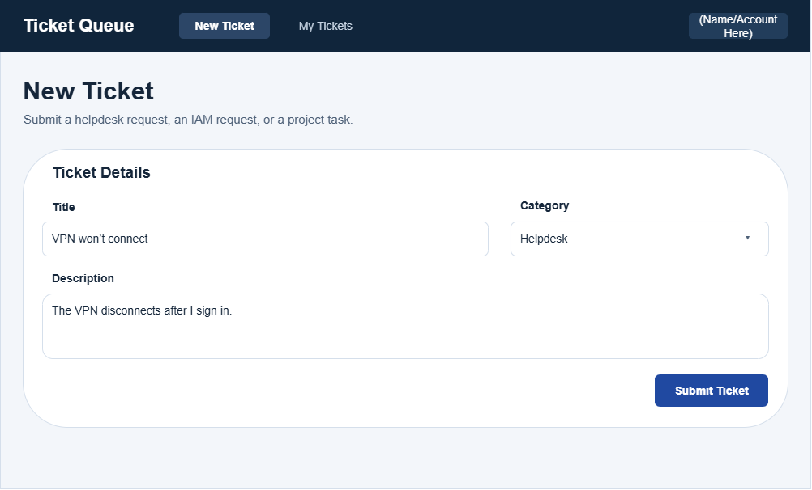
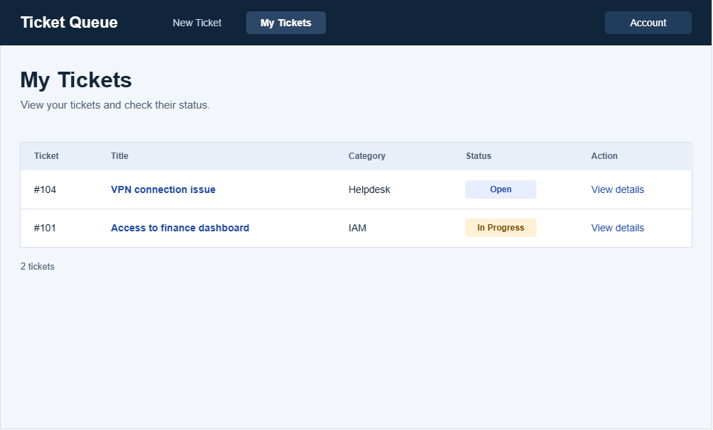
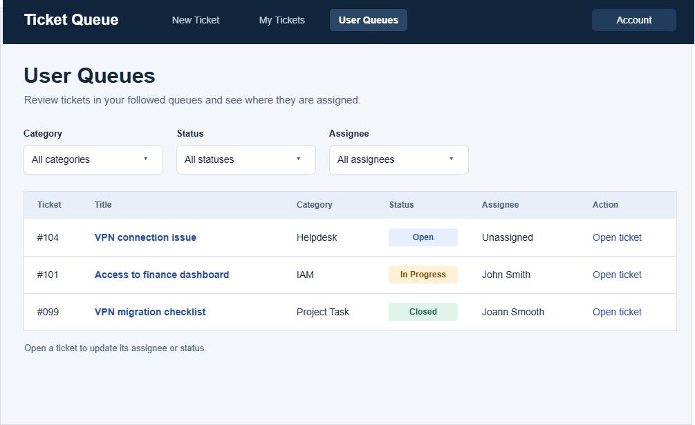
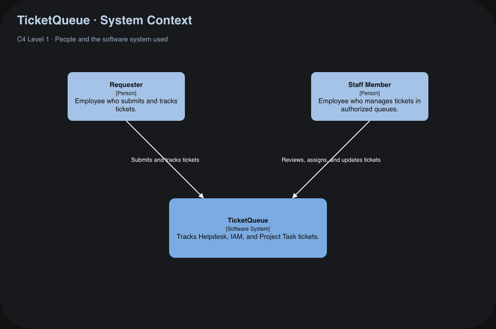
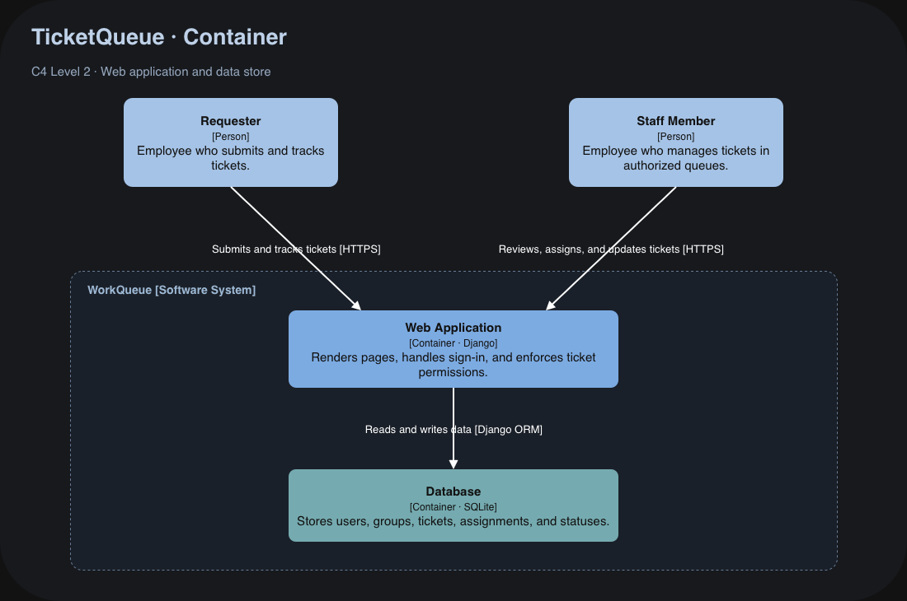
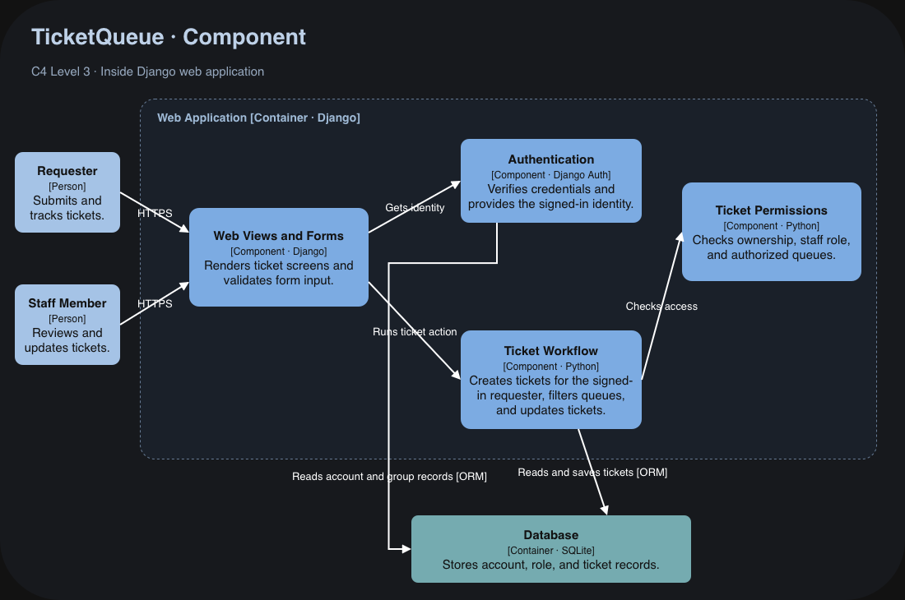

# TicketQueue
### A streamlined shared ticketing system for an IT team.

TicketQueue gives small IT teams one place to track helpdesk requests, identity & access management procedures, and internal project tasks. Requesters can see the status of their tickets, and staff can share queues to see what needs attention, reassign tasks, and note progress for the sake of review.

The current prototype includes a sign-in and a "My Tickets" page that shows tickets associated with the signed-in user. Ticket creation, shared queues, assignment, and status updates are planned features.

## Installation

TicketQueue requires Python 3.11 and Git. The following commands are for Windows PowerShell.

Clone the repository and open the cloned folder in your terminal.

```powershell
git clone https://github.com/marc-fayad/ticket-system.git
```

From the folder containing `manage.py`, create a virtual environment, install the dependencies, and initialize the SQLite database.

```powershell
py -3.11 -m venv .venv
.\.venv\Scripts\python.exe -m pip install -r requirements.txt
.\.venv\Scripts\python.exe manage.py migrate
```

## Usage

Create a local account the first time you set up WorkQueue. Follow the prompts to choose a username and password.

```powershell
.\.venv\Scripts\python.exe manage.py createsuperuser
```

Start the development server.

```powershell
.\.venv\Scripts\python.exe manage.py runserver
```

Open [http://127.0.0.1:8000/](http://127.0.0.1:8000/) and sign in with the account you created. TicketQueue opens the **My Tickets** page. A fresh database shows an empty ticket list.

Press **Ctrl+C** in the terminal to stop the server.

## License

TicketQueue is licensed under the [MIT License](LICENSE).

# Design

## User Stories

### US-01 - Submitting a ticket
User Story: As a requester, I want to submit a ticket that has a category and description so I can send my request to the team that handles it.

Acceptance Criterion: When I submit a ticket with a title, category, and subscription, it appears in "My Tickets" with the 'Open' status. 

### US-02 - Checking ticket status
User Story: As a requester, I want to see the current status of my submitted tickets so I can tell whether my requests are open, in progress, or closed.

Acceptance Criterion: After a team member changes my ticket from 'Open' to 'In Progress', I see the updated status next time I look at the ticket.

### US-03 - Filtering tickets
User Story: As a team member, I want to filter tickets by category, status, and assignee, so I can find the work I need to handle or what somebody else is assigned.

Acceptance Criterion: When I select a category like 'IAM' and a status like 'Open', the queue displays only open IAM tickets I can see.

## Misuse Stories

### MS-01 - Edit someone else's ticket
Misuse Story: As a requester, I want to modify the ticket someone else opened that I have not been given permission to.

Mitigation Criterion: When I modify a field in someone else's assigned ticket,  the server denies the change and shows a denial message.

### MS-02 - Submit a ticket in someone else's name
Misuse Story: As a requester, I want to submit a ticket under another employee's name so I can make it appear that they requested work or access.

Mitigation Criterion: When a user submits a ticket while singed in, the Ticket Queue records the user as the requester.

## UI Mockups

### Ticket Creation
Filling out a form to submit a ticket.

Supports US-01


### My Ticket Queue
Checking the status of tickets the user submitted or is assigned.

Supports US-02


### Followed Queues
Filter tickets by category, status, or assignee.

Supports US-03

## C4 Diagrams

### System Context Diagram


### Container Diagram


### Component Diagram


## Installation

WorkQueue requires Python 3.11 and Git. The following commands are for Windows PowerShell.

Clone the repository and open the cloned folder in your terminal.

```powershell
git clone <YOUR-REPOSITORY-URL>
```

From the folder containing `manage.py`, create a virtual environment, install the dependencies, and initialize the SQLite database.

```powershell
py -3.11 -m venv .venv
.\.venv\Scripts\python.exe -m pip install -r requirements.txt
.\.venv\Scripts\python.exe manage.py migrate
```

## Usage

Create a local account the first time you set up WorkQueue. Follow the prompts to choose a username and password.

```powershell
.\.venv\Scripts\python.exe manage.py createsuperuser
```

Start the development server.

```powershell
.\.venv\Scripts\python.exe manage.py runserver
```

Open [http://127.0.0.1:8000/](http://127.0.0.1:8000/) and sign in with the account you created. WorkQueue opens the **My Tickets** page. A fresh database shows an empty ticket list.

Press **Ctrl+C** in the terminal to stop the server.

## License

TicketQueue is licensed under the [MIT License](LICENSE).
